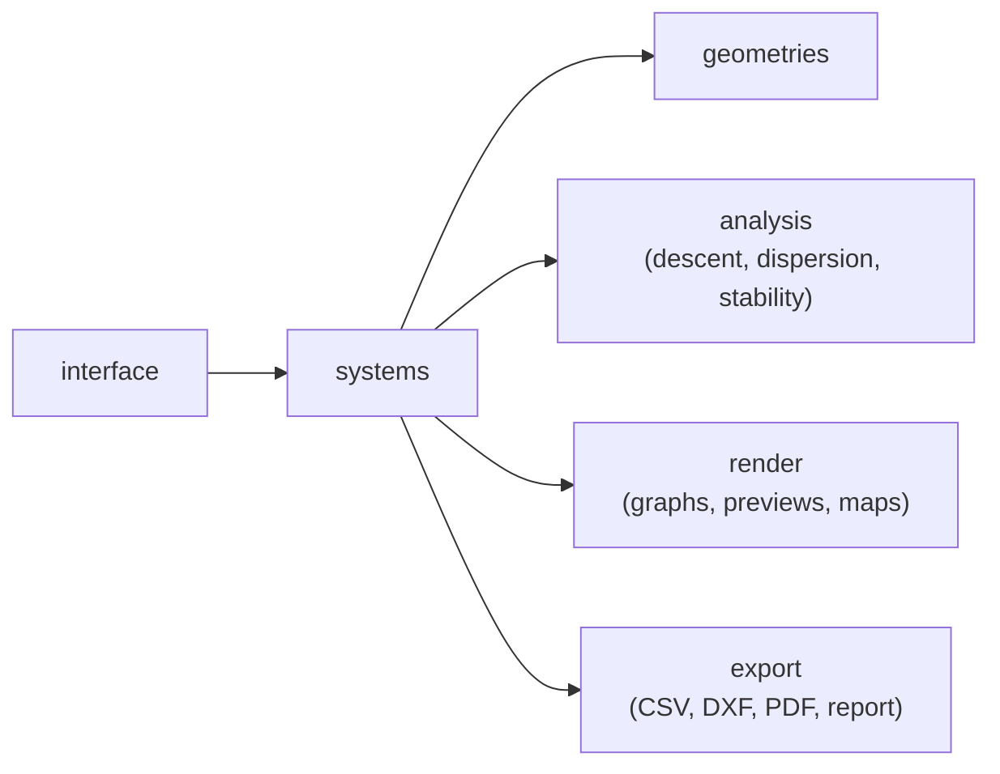

# yasradPDS

**SRAD Parachute Design System**: a simulation-based design tool for the
McMaster Rocketry team's parachute recovery systems. Size a canopy,
get the gore pattern to cut, and see the loads, descent and landing
dispersion that go with it.

## How it works

Everything revolves around one **system object** (for example a
dual-deploy drogue + main system). It is the canonical data store: it
holds the knowns and unknowns, and it is passed to every analysis,
render and export so they all read the same data.

**Inputs.** Each stage (drogue and main) takes its own knowns:

- canopy: geometry, gore count, fabric density, porosity
- deployment: deploy altitude (AGL), deploy velocity, target velocity
- masses and shock limits for the upper and lower sections
- lines: upper cord, lower cord and shroud (length, density, break
  strength, max elongation)

Both stages must carry the same total mass.

**Existing parachutes.** Main diameter, spill hole diameter and shroud
length are optional. Leave them empty and the system sizes the canopy.
Give both diameters and the stage is marked as an existing (already
made) parachute, which is not resized.

**Computed values.** The unknowns (canopy area, fill time, opening
shocks, canopy mass, gore outline) are not entered by hand. They are
computed from the knowns when the system is created.

**Input files.** Inputs are saved as JSON, so a design can be reloaded
and passed between commands. See
[`src/yasradPDS/config/sample_dual_deploy.json`](src/yasradPDS/config/sample_dual_deploy.json)
for an example.



Geometry objects are only imported by system files, so the shared code
works the same no matter which canopy shape is used.

## Setup

Requires Python 3.10 or newer.

```shell
python -m venv .venv
.venv\Scripts\activate          # Windows PowerShell
pip install -e .
```

This installs the dependencies from `pyproject.toml` and the
`yasradPDS` command.

## Usage

```shell
yasradPDS config                           # enter design values in the GUI and save them to JSON
yasradPDS create-system -i my_rocket.json  # build the system from a saved JSON file
yasradPDS create-system --show             # build it and print every stage's values
yasradPDS analyze [--preview]              # run the analyses (not implemented yet)
yasradPDS export {csv|pdf|dxf} -o FILE     # write data or gore templates (not implemented yet)
```

`config` opens the dual-deploy input window, with one tab per stage.
**Save** checks every field, asks where to write the JSON file, then
closes the window. **Import** loads a saved JSON file back into the
fields. `create-system` reads `system.json` in the current folder
unless `-i` points it to another file.

Every command runs on its own, so the JSON file is what carries the
inputs from one command to the next. See [`USAGE.txt`](USAGE.txt) for
every field, its units and the validation rules.

## Project layout

Code is under `src/yasradPDS/`.

| Folder | What it holds |
| --- | --- |
| `utils/` | Constants, unit conversion, atmosphere model, physics (all physics lives here) |
| `config/` | Default values (`defaults.json`), the code that loads them, and a sample input file |
| `geometries/` | Canopy shape interface (`Geometry`) and each shape, e.g. semi-ellipsoid (`semi_elipsoid`) |
| `systems/` | System interface and the dual-deploy drogue + main system |
| `analysis/` | RocketPy-assisted descent and opening shock, Monte Carlo dispersion, shroud line stability |
| `render/` | Time graphs, gore preview, 3D preview, dispersion map |
| `export/` | CSV data, DXF and PDF gore templates, text report, file saving |
| `interface/` | CLI command routing and the dual-deploy input GUI |

`main.py` is the entry point that starts the interface.

## Credits/Sources

- [RocketPy Library](https://rocketpy-team.github.io/)
